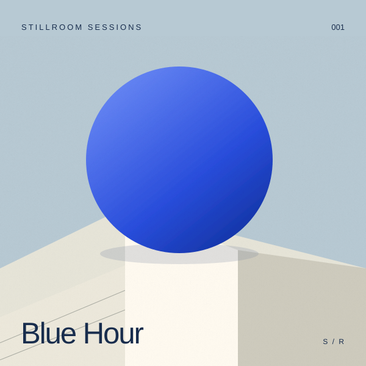

# Stillroom

**Make room for a good record.** An independent music listening experience by David Stroupe.

[**Open the live app →**](https://dnstroupe.github.io/stillroom/) | [Design case study](https://dnstroupe.github.io/stillroom/case-study.html) | [Editable Figma file](https://www.figma.com/design/w4ichthh1SMuQNj2Mk40c5?node-id=5-11) | [Portfolio](https://dnstroupe.github.io/data-design-portfolio/)



## Why this exists

A music-player exercise became an original product concept: a finite, mood-led edit that gives the listener control over a short listening session. The hypothesis is that a small, intentional selection may make choosing easier. It has not been validated through participant research.

## Try the experience

1. **Settle in & listen** starts the three-track edit.
2. Search or combine a query with a mood. Save a track with its heart.
3. Open the queue to reorder tracks, remove upcoming tracks, or lock the order.
4. Save a named listening session and return to it in **Your collection**.
5. Add your own audio. Files stay on your device and disappear on refresh.
6. Open Now Playing for the focused mobile controls. Try light and dark themes.

## Implemented

- Three full original Suno-generated instrumental tracks, bundled with the site.
- Responsive discovery and saved collection, combined search/mood filters and useful empty states.
- Real playback, seeking, previous/next, shuffle, repeat, volume and mute.
- Persistent playback across views, Media Session integration where supported.
- Editable queue, order lock, named saved sessions, and local-only audio import.
- Favorites, theme and volume persisted in browser storage with malformed-data recovery.
- Semantic controls, native modal dialogs, keyboard shortcuts and reduced-motion styles.
- Editable Figma desktop composition, reusable components, light/dark variables, eight mobile states with connected prototype flows.

## Run and test

No package installation or build step is required.

```sh
npm start
# Open http://localhost:4173
npm test
```

Node.js 20+ is sufficient for the test runner. Python 3 serves the local site. Opening `index.html` through `file://` is not supported because the app uses ES modules.

## Architecture

`index.html` provides semantic page and dialog structure. `app.js` coordinates one persistent audio element and view state. `core.js` contains testable queue, search, preference and formatting functions. `styles.css` contains the responsive design and theme tokens. `assets/` holds local audio, original vector sleeves, and licensed fonts.

No credentials, external API, user account, database, analytics SDK, or runtime dependencies are needed.

## Evidence and limitations

See [validation](docs/validation.md), [design decisions](docs/design-decisions.md), [requirements](docs/requirements.md), and [asset provenance](docs/assets.md).

This is an independent portfolio concept, created with AI-assisted design/implementation and AI-generated music. It is not affiliated with Spotify or Suno. No invented research, measured engagement improvement, formal accessibility certification, or perfect Figma parity is claimed. Participant feedback, complete screen-reader testing, and a full browser/device matrix remain future work.

## Credits

Concept and creative direction: David Stroupe. Implementation and design assistance: OpenAI Codex. Music: generated for this project using Suno v6 under the user's account. Geometric record sleeves: original project artwork. DM Sans and DM Serif Display: SIL Open Font License, included in `assets/`.

Source is published for portfolio review. Font licenses apply to their respective files. No blanket redistribution license is granted for the generated music.
